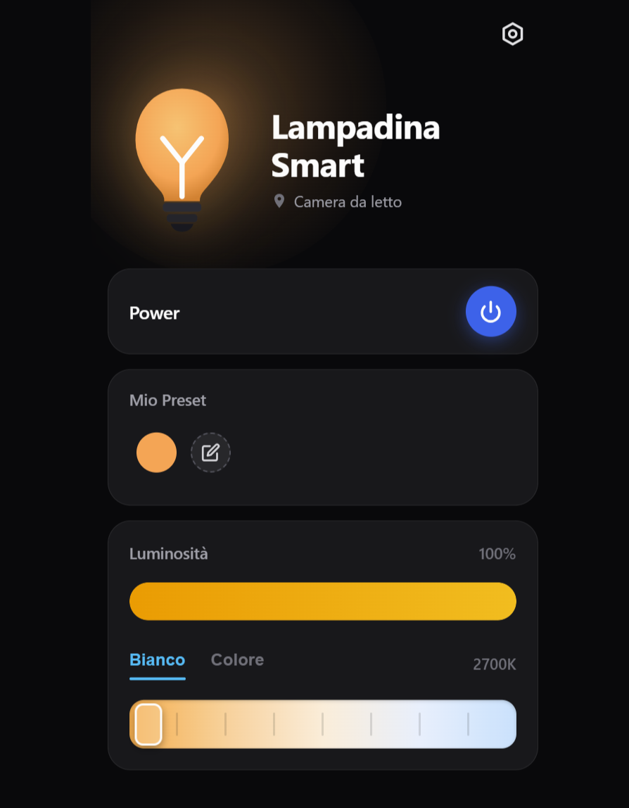
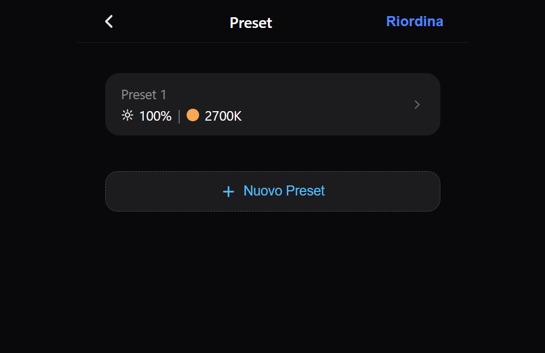
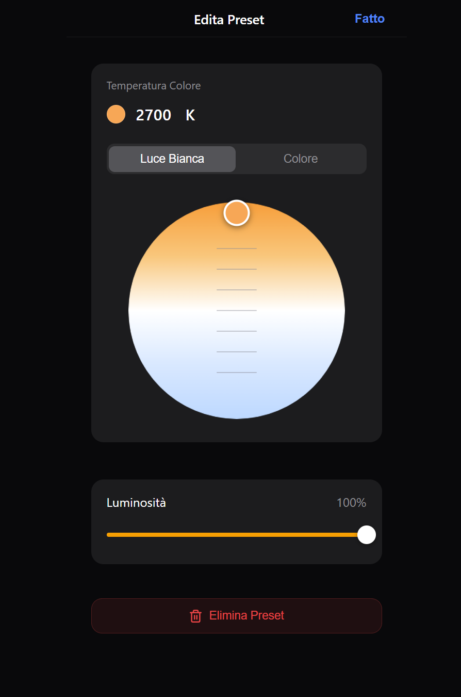

# Tapo L535 Controller

Local web app for controlling a TP-Link Tapo L535 smart bulb.

## Features

- Power, brightness, color temperature, and HSV color control
- Preset management
- FastAPI backend with `python-kasa`
- Docker deployment

## Setup

```bash
cp .env.example .env
```

Set the bulb IP and Tapo credentials in `.env`, then start the app:

```bash
docker compose up -d --build
```

Open:

```text
http://localhost:8081
```

## API examples

```bash
curl http://localhost:8081/api/state
curl -X POST http://localhost:8081/api/power/true
curl -X POST http://localhost:8081/api/brightness/75
curl -X POST http://localhost:8081/api/temp/4000
curl -X POST http://localhost:8081/api/color \
  -H "Content-Type: application/json" \
  -d '{"hue":280,"saturation":100,"value":100}'
```

## Screenshots







## Project structure

```text
main.py              FastAPI backend
static/              Web app
presets.json         Saved presets
Dockerfile           Container image
docker-compose.yml   Docker configuration
```
